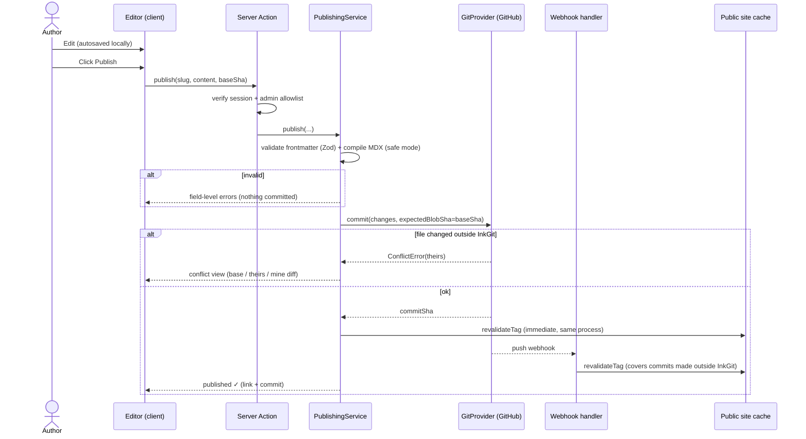

# InkGit — Architecture

> "Your content belongs to you. Your repository is your CMS. Your website is your presentation layer."

Status: **Approved — Phase 1 implemented** · Last updated: 2026-11-09

This document is the source of truth for InkGit's architecture. It is updated whenever an architectural decision changes. Decisions that rest on assumptions are marked **[ASSUMPTION]**; open questions are listed in §12.

---

## 1. Product Architecture

InkGit is a **modular monolith** built on Next.js (App Router). It has three logical layers that share one codebase and one deployment, but talk to each other only through well-defined module interfaces.

| Layer                     | Audience | Responsibility                                            | Reads                         | Writes                      |
| ------------------------- | -------- | --------------------------------------------------------- | ----------------------------- | --------------------------- |
| **Public Website**        | Readers  | Render published content fast, SEO, feeds, search         | Content index (cached)        | Nothing                     |
| **Admin Dashboard**       | Author   | Write, preview, publish, restore, manage media & taxonomy | Git provider (live, uncached) | Git provider, media storage |
| **Git Integration Layer** | Internal | Single gateway to the content repository                  | Git host API                  | Git host API                |

Key principle: **Git is the only durable store of content.** There is no database copy of articles to drift out of sync. Everything the public site shows is derived from a specific commit of the content repository.

### Core domain concepts

- **Article** — one `.mdx` file: validated frontmatter + MDX body.
- **Page** — a standalone document (e.g. About) using the same pipeline with a lighter schema.
- **Taxonomy** — tags and categories. Tags are free-form (derived from articles). Categories are a curated list in `taxonomy.yml` so they can carry a description and stable slug.
- **Revision** — a Git commit that touched an article. History and restore operate on revisions.
- **Media asset** — an uploaded image stored in object storage, referenced from MDX by URL.

---

## 2. System Architecture

```mermaid
flowchart LR
    subgraph Clients
        R[Reader browser]
        A[Author browser]
    end

    subgraph Vercel["Next.js app (Vercel) — modular monolith"]
        direction TB
        subgraph Public["Public website (RSC, ISR)"]
            PW[Pages: home, blog, article,<br/>tags, categories, search, about]
            FEEDS[rss.xml · sitemap.xml · robots · OG images]
        end
        subgraph Admin["Admin dashboard (protected)"]
            AD[Dashboard · Articles · Editor<br/>Media · Taxonomy · History]
            SA[Server Actions / Route Handlers]
        end
        MW[Middleware: auth gate on /admin]
        subgraph Core["Domain & application modules (server-only)"]
            CS[ContentService<br/>parse · validate · index]
            PS[PublishingService<br/>draft · publish · restore · conflicts]
            RP[Rendering pipeline<br/>remark/rehype · safe MDX · Shiki]
            MS[MediaService]
            SS[SearchService]
        end
        subgraph Infra["Infrastructure adapters"]
            GP[[GitProvider interface]]
            GH[GitHubProvider]
            LF[LocalFsProvider (dev/tests)]
            ST[[MediaStorage interface]]
            S3[S3-compatible adapter]
        end
        AUTH[Auth.js — GitHub OAuth]
        WH[/api/webhooks/git/]
    end

    GHAPI[(GitHub API<br/>content repo)]
    OBJ[(Object storage<br/>images)]
    GHA[GitHub Actions<br/>validate content on PR/push]

    R --> PW & FEEDS
    A --> MW --> AD --> SA
    A -. OAuth .-> AUTH
    PW --> CS --> GP
    PW --> RP
    SA --> PS --> GP
    SA --> MS --> ST
    SA --> RP
    PW --> SS --> CS
    GP --> GH --> GHAPI
    GP --> LF
    ST --> S3 --> OBJ
    GHAPI -- push webhook (HMAC signed) --> WH -- revalidateTag --> PW
    GHAPI --> GHA
```

### Publishing sequence



### Why these choices

- **Modular monolith on Next.js** — one deployable, server-only modules enforce boundaries (`import "server-only"`), no network hops between layers. A separate backend would add ops cost with no current benefit.
- **ISR + on-demand revalidation instead of full rebuilds** — a publish becomes visible in seconds, not after a 1–3 min Vercel build; build time stays flat as content grows. The webhook also catches edits made directly in GitHub, keeping Git the true source. A Vercel deploy hook remains a fallback.
- **Services depend on interfaces (`GitProvider`, `MediaStorage`)** — dependency inversion lets us swap GitHub for GitLab/Gitea, and use a local filesystem provider for development and fast tests.

---

## 3. Folder Structure

```
inkgit/
├─ ARCHITECTURE.md · TODO.md · README.md
├─ content/                    # sample/dev content (Phase 1 local source; mirrors content repo layout)
│  ├─ posts/<slug>.mdx
│  ├─ pages/about.mdx
│  └─ taxonomy.yml             # curated categories
├─ src/
│  ├─ app/
│  │  ├─ (public)/             # route group: public layout (header/footer)
│  │  │  ├─ page.tsx           # home
│  │  │  ├─ blog/page.tsx · blog/[slug]/page.tsx
│  │  │  ├─ tags/[tag]/page.tsx · categories/[category]/page.tsx
│  │  │  ├─ search/page.tsx · about/page.tsx
│  │  ├─ admin/                # protected area: sidebar layout
│  │  │  ├─ page.tsx           # overview
│  │  │  ├─ articles/page.tsx · articles/new/page.tsx · articles/[slug]/page.tsx
│  │  │  ├─ articles/[slug]/history/page.tsx
│  │  │  ├─ preview/[slug]/page.tsx
│  │  │  ├─ media/ · taxonomy/ · settings/
│  │  ├─ api/
│  │  │  ├─ auth/[...nextauth]/route.ts
│  │  │  ├─ webhooks/git/route.ts
│  │  │  └─ admin/media/route.ts   # multipart upload (Server Actions have body limits)
│  │  ├─ rss.xml/route.ts · sitemap.ts · robots.ts · opengraph-image.tsx
│  │  └─ layout.tsx · globals.css · not-found.tsx · error.tsx
│  ├─ components/
│  │  ├─ ui/                   # shadcn/ui primitives (generated, lightly edited)
│  │  ├─ site/                 # public components (ArticleCard, Toc, ReadingProgress…)
│  │  ├─ admin/                # admin components (ArticleTable, Editor, HistoryList…)
│  │  └─ mdx/                  # allowlisted MDX components (Callout, CodeBlock, Figure…)
│  ├─ modules/                 # domain + application logic (server-only unless noted)
│  │  ├─ content/              # schema.ts (Zod), parse.ts, slug.ts, content-service.ts, index.ts
│  │  ├─ rendering/            # pipeline.ts (remark/rehype/MDX), toc.ts, reading-time.ts (isomorphic)
│  │  ├─ publishing/           # publishing-service.ts, conflicts.ts, commit-messages.ts
│  │  ├─ git/                  # provider.ts (interface + errors), paths.ts (path guard)
│  │  │  ├─ github/            # github-provider.ts (Octokit)
│  │  │  └─ local/             # local-fs-provider.ts
│  │  ├─ media/                # media-service.ts, storage.ts (interface), s3-storage.ts, validate.ts
│  │  ├─ search/               # search-service.ts (MiniSearch index)
│  │  └─ auth/                 # auth.ts (Auth.js config), guards.ts (requireAdmin)
│  ├─ lib/                     # env.ts (Zod-validated env), errors.ts, logger.ts, utils.ts
│  ├─ config/site.ts           # site metadata, nav, socials (non-secret)
│  └─ proxy.ts                 # (Phase 2) coarse /admin gate — Next 16 renamed middleware to proxy
├─ tests/
│  ├─ unit/ · integration/ (LocalFsProvider + mocked GitHub) · e2e/ (Playwright)
│  └─ fixtures/content/        # valid + deliberately malformed articles
├─ .github/workflows/          # ci.yml (lint, typecheck, test), content-validate.yml (reusable for content repo)
└─ .env.example                # names only, never values
```

Dependency rule: `app/` → `modules/*` services → `modules/git|media` interfaces ← adapters. UI components never import adapters or Octokit. Modules never import from `app/` or `components/` (except `rendering` mapping to `components/mdx`).

---

## 4. Database & Content Storage Strategy

| Data                                            | Store                                             | Rationale                                                                   |
| ----------------------------------------------- | ------------------------------------------------- | --------------------------------------------------------------------------- |
| Articles, pages, taxonomy                       | **Git content repo**                              | Ownership, history, portability, review via PRs                             |
| Images / media                                  | **Object storage** (S3-compatible)                | Keeps repo small; CDN-served; Git stores only URLs                          |
| Drafts                                          | **Git** (`published: false`)                      | Versioned, survives devices; see note on visibility                         |
| Unsaved edits (autosave)                        | **Browser IndexedDB** (per article, per base SHA) | Autosave every keystroke without polluting Git history                      |
| Sessions                                        | Auth.js **JWT** (encrypted cookie)                | No DB needed for a single-author MVP                                        |
| Analytics, comments, multi-user, scheduled jobs | **PostgreSQL** (Phase 4+, Drizzle ORM)            | Not needed for MVP — introduce only when a feature requires relational data |

**Content repo layout** (configurable root):

```
posts/<slug>.mdx       pages/<slug>.mdx       taxonomy.yml       .inkgit/schema-version
```

One file per article keeps diffs, history, and conflicts per-article. Filename = slug (single source of identity); a frontmatter `slug` that disagrees with the filename is a validation error.

**Content schema** (Zod, version 1):

| Field          | Type     | Rule                                                              |
| -------------- | -------- | ----------------------------------------------------------------- |
| `title`        | string   | 1–200 chars, required                                             |
| `slug`         | string   | `^[a-z0-9]+(?:-[a-z0-9]+)*$`, ≤ 100, must equal filename          |
| `description`  | string   | ≤ 300, required (SEO)                                             |
| `date`         | ISO date | required; future date + published ⇒ scheduled (Phase 4)           |
| `updatedAt`    | ISO date | optional, ≥ `date`; set automatically on publish                  |
| `author`       | string   | defaults from config                                              |
| `tags`         | string[] | ≤ 10, normalized to kebab-case slugs for URLs, display label kept |
| `categories`   | string[] | must exist in `taxonomy.yml`                                      |
| `coverImage`   | string   | absolute https URL on allowed media host, or `/`-relative path    |
| `coverAlt`     | string   | required if `coverImage` set (accessibility) **[ADDITION]**       |
| `published`    | boolean  | default `false`                                                   |
| `featured`     | boolean  | default `false`                                                   |
| `canonicalUrl` | URL      | optional **[ADDITION]**                                           |
| `redirectFrom` | string[] | old slugs, for safe renames **[ADDITION]**                        |

**Malformed content can't break the site:** every file is parsed and validated independently. An invalid file is excluded from the public index, logged, and surfaced in the admin "Content health" panel; it never throws during page render. Content entering via InkGit is validated _before_ commit; content pushed directly to Git is validated by the CI workflow and again at index time.

---

## 5. Git Integration Design

### Interface (sketch — shapes, not implementation)

```ts
interface GitProvider {
  readonly name: "github" | "gitlab" | "local";
  getHead(branch?: string): Promise<{ commitSha: string }>;
  listTree(dir: string, ref?: string): Promise<TreeEntry[]>; // path, blobSha, size
  readFile(path: string, ref?: string): Promise<GitFile | null>; // content, blobSha
  commit(req: CommitRequest): Promise<CommitResult>; // atomic, multi-file
  getHistory(q: { path?: string; limit: number; cursor?: string }): Promise<Page<CommitSummary>>;
  readFileAtCommit(path: string, commitSha: string): Promise<GitFile | null>;
  createBranch(name: string, fromSha: string): Promise<void>;
}

interface CommitRequest {
  branch: string;
  message: string;
  author: { name: string; email: string };
  expectedHeadSha?: string; // fail if branch moved (whole-repo guard)
  changes: Array<
    | { op: "upsert"; path: string; content: string; expectedBlobSha: string | null } // null = must not exist
    | { op: "delete"; path: string; expectedBlobSha: string }
  >;
}
// Errors: ConflictError (with current remote file), NotFoundError, RateLimitError, ValidationError, ProviderError
```

### GitHub implementation

- Uses the **Git Data API** (blobs → tree → commit → update ref with `force: false`) for atomic multi-file commits (e.g. rename = delete old + create new in one commit). Single-file paths can use the Contents API.
- **Optimistic concurrency, two levels:**
  1. _Per-file_: before committing, compare each change's `expectedBlobSha` with the file's blob SHA at the current head. Mismatch ⇒ `ConflictError` with the remote version. This allows unrelated commits to the repo without false conflicts.
  2. _Ref update_: `force: false` means a concurrent push between our read and write rejects the update; we re-read head and re-check per-file SHAs (bounded retry, max 3).
- **Never overwrite silently.** On conflict the editor shows a diff of _theirs_ vs _mine_; the author chooses: take theirs, keep mine (explicit overwrite, recorded in commit message), or merge manually.
- **History** = `GET /commits?path=` paginated. **Restore** = read file at commit X, then commit it as a _new_ commit ("Restore <slug> to <short-sha>"). History is never rewritten.
- **Branches** are used only where needed: optional "publish via PR" mode and scheduled posts (Phase 4). The MVP commits to the configured branch.
- **Path guard:** all writes go through `paths.ts`, which builds paths from validated slugs only, normalizes, and rejects anything outside the allowlisted prefixes (`posts/`, `pages/`, `taxonomy.yml`). The provider re-checks before any API call (defense in depth).
- **Reads for the public site** use one recursive tree call + blob fetches, wrapped in Next.js cache with tags (`content`, `post:<slug>`), so a normal page view makes **zero** GitHub API calls.
- Commit messages are conventional: `content(publish): <slug>`, `content(draft): <slug>`, `content(delete): <slug>`, `content(restore): <slug> → <sha>`, with a trailer `Via: InkGit`.

### Credentials

Repository writes use a **server-only credential** scoped to the content repo (fine-grained PAT for MVP, GitHub App installation token as the production target). The author's OAuth token is used only for identity — never for repo writes and never sent to the browser. Commits are attributed to the signed-in author's name/email.

---

## 6. API Design

Mutations are **Server Actions** (typed, co-located, CSRF-protected by Next's origin check). Route handlers exist only where an HTTP endpoint is genuinely required.

**Server Actions** (all call `requireAdmin()` first, validate input with Zod, return `Result<T, AppError>`):

| Action             | Input                         | Notes                                          |
| ------------------ | ----------------------------- | ---------------------------------------------- |
| `saveDraft`        | slug, raw MDX, baseBlobSha    | commits with `published:false`                 |
| `publishArticle`   | slug, raw MDX, baseBlobSha    | validates, sets `published:true`, `updatedAt`  |
| `unpublishArticle` | slug, baseBlobSha             |                                                |
| `deleteArticle`    | slug, baseBlobSha             | confirm in UI; recoverable via history         |
| `renameArticle`    | oldSlug, newSlug, baseBlobSha | atomic delete+create, appends `redirectFrom`   |
| `restoreRevision`  | slug, commitSha, baseBlobSha  | new commit                                     |
| `renderPreview`    | raw MDX                       | same pipeline as public site, no commit        |
| `updateTaxonomy`   | categories[], baseBlobSha     |                                                |
| `deleteMedia`      | key                           | refuses if referenced (Phase 4 reference scan) |

**Route handlers:**

| Route                                     | Method     | Auth                       | Purpose                                          |
| ----------------------------------------- | ---------- | -------------------------- | ------------------------------------------------ |
| `/api/auth/[...nextauth]`                 | GET/POST   | —                          | Auth.js                                          |
| `/api/webhooks/git`                       | POST       | HMAC `X-Hub-Signature-256` | revalidate tags for changed paths                |
| `/api/admin/media`                        | POST       | session + admin            | multipart upload, validated, streamed to storage |
| `/rss.xml`, `/sitemap.xml`, `/robots.txt` | GET        | public                     | feeds/SEO                                        |
| `/search`                                 | GET (page) | public                     | server-side search via `?q=`                     |

---

## 7. Security Considerations

| Threat                            | Mitigation                                                                                                                                                                                                                       |
| --------------------------------- | -------------------------------------------------------------------------------------------------------------------------------------------------------------------------------------------------------------------------------- |
| Token leakage                     | Repo credential only in server env; modules marked `server-only`; env validated by Zod at boot; no `NEXT_PUBLIC_` secrets; lint rule against importing server modules in client components                                       |
| Unauthorized admin access         | Auth.js GitHub OAuth + **allowlist of GitHub numeric user IDs** (not usernames, which can change). Middleware gates `/admin`; every Server Action and route handler re-checks (`requireAdmin`) — middleware alone is not trusted |
| CSRF                              | Server Actions' built-in origin check; SameSite=Lax cookies; route handlers check `Origin`                                                                                                                                       |
| XSS via content                   | Markdown → HTML through rehype with `rehype-sanitize` for raw HTML; **safe MDX**: imports/exports and JS expressions stripped by a remark plugin, only allowlisted components available. Strict CSP with nonces                  |
| MDX code execution                | Same as above — MDX is code; we never `eval` arbitrary ESM from the repo                                                                                                                                                         |
| Path traversal / arbitrary writes | Slug regex; server-side path construction; prefix allowlist checked twice; filenames from uploads are never used as storage keys (content-hash keys)                                                                             |
| Malicious uploads                 | Allowlist MIME (`png, jpeg, webp, gif, avif`; SVG excluded or sanitized), verify magic bytes not just extension, max 5 MB (configurable), strip EXIF, randomized keys, served from a separate origin/bucket domain               |
| Webhook spoofing                  | HMAC SHA-256 verification with constant-time compare; ignore unknown events; idempotent handling                                                                                                                                 |
| Abuse / brute force               | Rate limits on auth, upload and publish endpoints                                                                                                                                                                                |
| Secrets in Git                    | `.env*` in `.gitignore`; `.env.example` has names only; secret scanning in CI                                                                                                                                                    |
| Supply chain                      | Minimal dependencies, lockfile committed, Dependabot, `npm audit` in CI                                                                                                                                                          |

---

## 8. Phase-wise Roadmap & Acceptance Criteria

See `TODO.md` for the live task list. Summary:

**Phase 1 — Foundation (local content).**
Next.js + TS strict + Tailwind + shadcn/ui + Lucide; ESLint/Prettier/Vitest; Zod env; content schema + parser; rendering pipeline (Shiki, TOC, reading time); `ContentService` over `LocalFsProvider`; public layout, home, blog list, article, tag, category, about; dark/light theme.
_Acceptance:_ `pnpm build` passes with zero type errors; all sample articles render with highlighted code, copy button, TOC, progress bar, reading time; a malformed fixture is excluded with a logged warning and no crash; unpublished posts never appear; Lighthouse ≥ 95 perf/a11y/SEO on article page; schema/parser unit tests pass.

**Phase 2 — Content management.**
Auth.js + allowlist; admin shell; article table with search/filter; CodeMirror 6 editor with toolbar, live preview, word count, reading time, IndexedDB autosave; draft/preview flows (against LocalFsProvider).
_Acceptance:_ non-allowlisted GitHub user gets 403 on every admin route and action (tested); editor stays responsive on a 10k-word doc; preview output is byte-identical to public render; autosave recovers after tab close; content stored as MDX only.

**Phase 3 — Git integration.**
`GitHubProvider`; create/update/delete/rename via atomic commits; conflict detection + UI; publish workflow; webhook revalidation; history viewer with diff; restore.
_Acceptance:_ publish → visible on public site in < 10 s; an edit made directly on GitHub is detected as a conflict, never overwritten; restore creates a new commit; integration tests cover conflict, rate-limit and not-found paths; no token appears in client bundles (checked in CI).

**Phase 4 — Advanced.**
Search (MiniSearch), RSS, sitemap, OG images, JSON-LD; media upload/library; related articles (tag/category overlap); scheduled publishing; privacy-friendly analytics (Postgres if needed).
_Acceptance:_ RSS & sitemap validate; uploads reject wrong types/oversize/spoofed MIME; scheduled post appears within one revalidation window of its date.

**Phase 5 — Production readiness.**
Security review; e2e tests (Playwright) for publish/conflict/restore; CSP; performance pass; GitHub App credentials; Vercel + GitHub Actions deployment; README and setup docs.
_Acceptance:_ CI green on lint/typecheck/unit/integration/e2e; documented one-command setup; security checklist in §7 verified.

**MVP = Phases 1–3** plus RSS and sitemap.

---

## 9. Potential Technical Challenges

1. **GitHub API rate limits** (5,000 req/h) — solved by tag-based caching; public traffic never hits GitHub directly.
2. **MDX safety vs. power** — safe mode limits authors to allowlisted components; trade-off documented.
3. **Preview fidelity** — the preview must use the exact production pipeline; we render on the server via a debounced action rather than a separate client-side renderer.
4. **Conflict UX** — detecting conflicts is easy; presenting them clearly is the hard part. MVP: side-by-side diff + three explicit choices.
5. **Slug renames** — breaking URLs; handled by `redirectFrom` → Next.js redirects.
6. **Cache staleness** — missed webhooks; mitigated by a time-based revalidation backstop (e.g. 1 h) and a manual "Refresh content" button.
7. **Large files** — Contents API limits (1 MB for some reads); we use blob API for reads and keep media out of Git.
8. **Serverless limits** — request body and duration limits on Vercel; uploads go through a route handler (or direct-to-storage presigned URLs).
9. **Dates & time zones** — store ISO dates; site time zone in config; scheduled publishing compares in UTC.
10. **Orphaned media** — no reference counting in MVP; Phase 4 adds a reference scan before delete.

---

## 10. Explicit Assumptions

- Single author, single blog for MVP; data model avoids hard-coding that (author field, config object) so multi-author can be added later.
- Content repository is **private** (drafts live in Git and would otherwise be public).
- English only; no i18n in MVP.
- No comments system in MVP.
- Package manager: pnpm. Test runner: Vitest; e2e: Playwright.
- Editor: CodeMirror 6 (raw Markdown, fast, accessible) rather than a WYSIWYG editor, so stored content is always clean MDX.

---

## 11. Library Choices (minimal set)

`next`, `react`, `typescript`, `tailwindcss`, shadcn/ui (`radix-ui`, `class-variance-authority`, `tailwind-merge`), `lucide-react`, `next-themes`, `zod`, `gray-matter`, `@mdx-js/mdx` + `unified`/`remark-gfm`/`rehype-slug`/`rehype-autolink-headings`/`rehype-sanitize`, `shiki` (via `rehype-pretty-code`), `reading-time`, `@codemirror/*`, `octokit`, `next-auth` (Auth.js v5), `minisearch`, `@aws-sdk/client-s3` (or the chosen storage SDK), `vitest`, `@playwright/test`.

---

## 12. Decisions (resolved 2026-11-09 — defaults approved)

| #   | Question            | Decision                                                                                                                             |
| --- | ------------------- | ------------------------------------------------------------------------------------------------------------------------------------ |
| D1  | Where content lives | Separate **private** content repo (e.g. `inkgit-content`), configurable. Local `content/` folder mirrors its layout for dev/Phase 1. |
| D2  | Drafts              | Committed to Git with `published: false` (safe because the repo is private). Autosave stays in the browser.                          |
| D3  | Media storage       | Cloudflare R2 behind the S3-compatible `MediaStorage` interface.                                                                     |
| D4  | Repo credential     | Fine-grained PAT scoped to the content repo for MVP → GitHub App before launch. OAuth is identity only.                              |
| D5  | MDX                 | Restricted "safe MDX" (allowlisted components, no imports/expressions).                                                              |
| D6  | Misc                | pnpm; English only; no comments in MVP; branding placeholders in `src/config/site.ts` until provided.                                |

## 13. Implementation Notes (Phase 1)

Things that differ from, or refine, the original plan:

- **Next.js 16 with Cache Components.** `cacheComponents` + `partialPrefetching` are on (framework defaults). Data access goes through `'use cache'` functions in `modules/content/queries.ts`, tagged `content` with a `cacheLife("hours")` backstop. Phase 3's webhook calls `revalidateTag("content")`. MDX compilation is also a `'use cache'` function (`cacheLife("max")`) — it is pure in its inputs, and Cache Components treats Shiki's async grammar loading as uncached I/O otherwise.
- **Interface segregation for Git.** Phase 1 defines only `GitReader` (`listFiles`, `readFile`). `GitWriter` / history capabilities are added in Phases 2–3 and composed into `GitProvider`, so no provider ever has stub methods. `LocalFsProvider` reports real Git blob SHAs, so concurrency checks behave identically for local and GitHub content.
- **Composition root.** `modules/content/container.ts` is the only place that picks a concrete provider (`CONTENT_SOURCE`).
- **Content validation is two-tier.** _Errors_ exclude a file (bad YAML, schema violations, slug/filename mismatch, duplicate slug). _Warnings_ keep it (unknown category, missing `coverAlt`). All issues are logged and kept on `ContentIndex.issues` for the Phase 2 content-health panel. `coverAlt` is optional (falls back to the title) so the documented frontmatter example stays valid.
- **Categories** are curated in `taxonomy.yml` (name/slug/description). Articles may reference them by name or slug. Without `taxonomy.yml`, categories are derived from articles.
- **Safe MDX** (`modules/rendering/remark-safe-mdx.ts`): removes ESM and expressions, keeps an allowlist of components (`Callout`) and safe HTML tags, drops `script`/`iframe`/`form`/`svg`/… with their contents, strips `on*`/`style`/expression/spread attributes and unsafe URL schemes. `.md` files compile as plain Markdown (raw HTML ignored). Covered by unit tests.
- **Rendering failures never break the site.** Compile errors render an inline notice (and log); a route-level `error.tsx` catches runtime render errors.
- **shadcn/ui is vendored.** The registry host (`ui.shadcn.com`) was blocked in the build environment, so the needed primitives (button, badge, separator, skeleton, dropdown-menu) were written from shadcn's source. `components.json` is present so `shadcn add` works normally elsewhere.
- **Fonts** are self-hosted from the `geist` package (no build-time network). Only the sans font is preloaded.

### Known limitations

- **Soft 404 for unlisted params.** With Partial Prefetching, a URL not returned by `generateStaticParams` (e.g. `/blog/unknown`) streams the 404 UI with `<meta name="robots" content="noindex">` but HTTP **200** — documented Next.js behaviour once streaming starts. Drafts are never rendered. A `proxy.ts` slug check can return a hard 404 later if needed.
- **Performance.** Lighthouse (simulated mobile, local `next start`): home 94–96, article 93–94, accessibility/best-practices/SEO 100. Article LCP is dominated by render delay under throttling; to be re-measured on Vercel (CDN + compression) in Phase 5.
